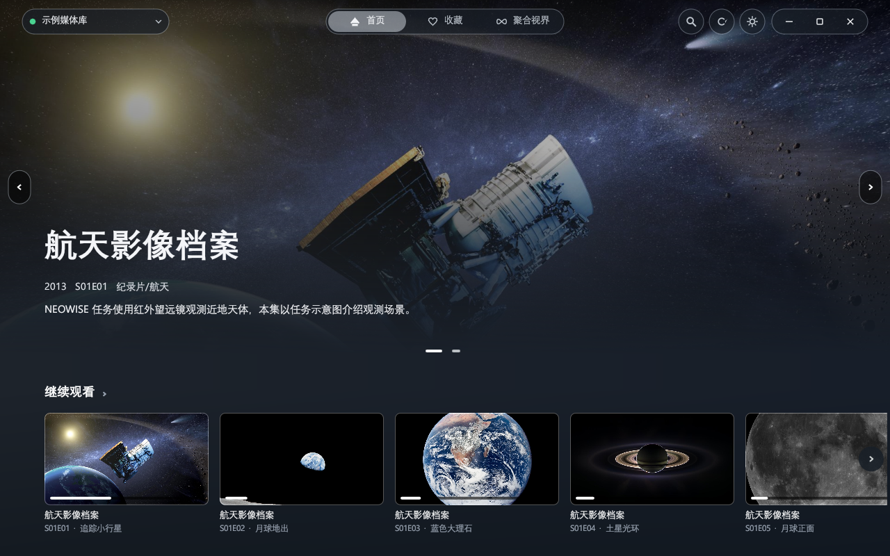
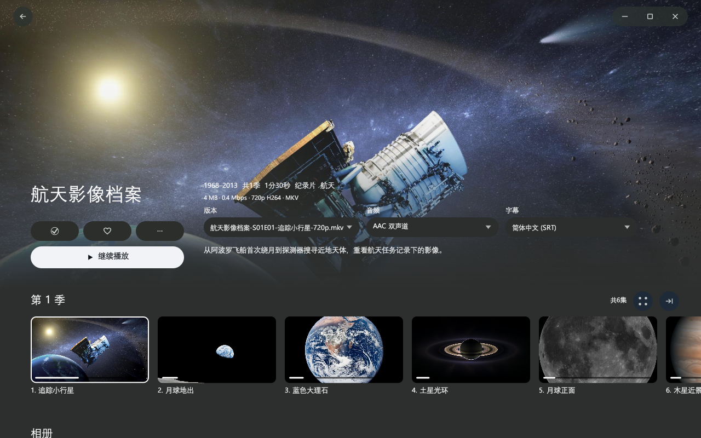
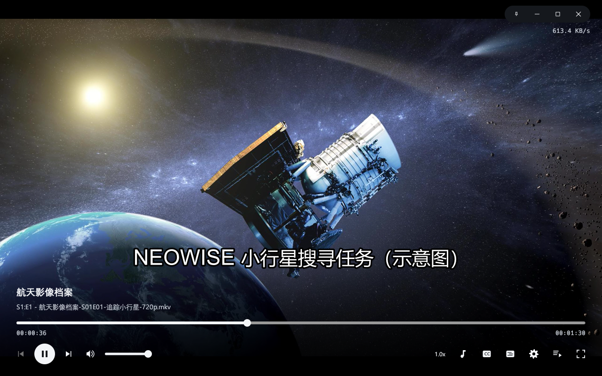
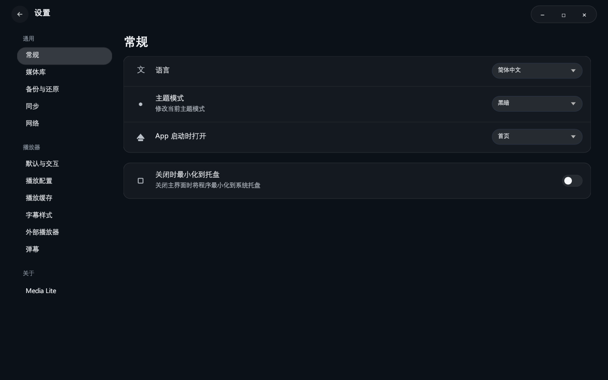

# Media Lite

Media Lite 是用 Rust 和 egui 编写的 Windows Emby 客户端。支持多服务器、媒体库浏览、收藏、搜索、续播，以及通过 libmpv 切换音轨和字幕。

## 下载与更新

从最新发布下载 Windows x64 ZIP，解压完整目录并运行 `Media Lite.exe`。发布页同时提供 ZIP 的 SHA-256 校验文件。[下载最新版本](https://github.com/WangYiQian0821/media-lite/releases/latest)

在「设置 → Media Lite」选择「检查更新」，可查看最新稳定版并下载 Windows 便携包。「启动时检查更新」默认开启，可在同一页关闭。升级时将新版解压到新目录，再运行新版程序。

服务器和本机设置存放在 `%APPDATA%\MediaLite\config-v2.json`。首次启动时会从同目录的旧版 `config.json` 导入配置。这个文件可能含有登录令牌，请妥善保管。

## 在线弹幕和字幕

- 在「设置 → 弹幕 → 自定义弹幕 API」填写兼容 DandanPlay v2 的服务根地址或 `/api/v2` 地址，支持反向代理子路径。播放时点「弹幕 → 搜索弹幕」，确认片名和集数，选择匹配结果即可载入当前视频。也可直接在搜索窗口保存 API 地址。[DandanPlay API 文档](https://api.dandanplay.net/swagger/index.html)
- 播放时点「字幕 → 搜索字幕 · SubtitleCat」，用预填的片名和集号搜索，选择结果及语言即可下载并加载可用的 SRT。需要翻译的语种可在字幕详情中点「在 SubtitleCat 打开」，下载后通过「打开字幕文件」载入。[SubtitleCat](https://www.subtitlecat.com/)

## 客户端界面

截图来自 Media Lite 0.1.6 Windows 便携版，使用本地示例媒体库。

### 首页



### 详情页



### 播放器



### 设置



示例画面取自 NASA 图库，原图署名见对应条目。[NEOWISE](https://images.nasa.gov/details/PIA17254) · [阿波罗 8 号](https://images.nasa.gov/details/as08-14-2383) · [阿波罗 17 号](https://images.nasa.gov/details/as17-148-22727) · [土星光环](https://images.nasa.gov/details/PIA08329) · [月球正面](https://images.nasa.gov/details/PIA00302) · [木星](https://images.nasa.gov/details/PIA00343)

## 构建

在 Windows x64 上用 Rust 工具链构建。若使用 MinGW，建议在纯 ASCII 路径下构建。

```powershell
cargo build --release --locked
```

播放需要 Windows x64 的 libmpv 0.42.0。把 `libmpv-2.dll` 放在可执行文件旁的 `runtime` 文件夹，或通过 `MPV_DLL` 指定兼容 DLL。便携包包含所用运行库和第三方许可。[mpv 0.42.0](https://github.com/mpv-player/mpv/releases/tag/v0.42.0)

## 发布新版

更新 `Cargo.toml` 和 `Cargo.lock` 中的版本，构建并打包为 `MediaLite-X.Y.Z-Windows-x64.zip`。在 GitHub Releases 发布对应的 `vX.Y.Z` 标签，附上 ZIP 和 SHA-256 校验文件，并设为最新正式版本。
